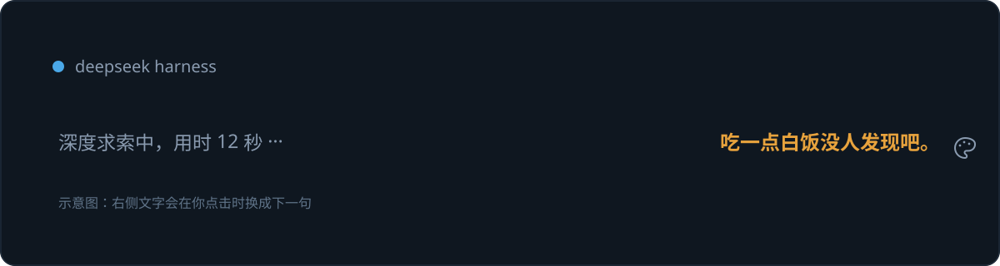

# 深度求索想法 / Deep-Diving Thoughts

原来的「深度求索中，用时 …」那一行和它的小鲸鱼动画**完全不动**。插件只在同一水平线的右边加一行文字；点一下换下一句。**只显示文字，不加「DeepSeek 在想」前缀。**



## 安装

这个文件夹同时是 DSH bundle 和 deepseekskill 的 skill 资源：

- **bundle**：用 `plugin_manager` 的 `install_bundle`，target 指向本文件夹
- **skill**：读取同目录的 [SKILL.md](SKILL.md)

### 从 npm 安装

> npm 包发布前，请先用下面的 GitHub 安装方式。

```bash
# Desktop
dsh plugin --profile desktop add dsh-thought-fish

# Web
dsh plugin --profile web add dsh-thought-fish
```

### 从 GitHub 安装

```bash
# Desktop
dsh plugin --profile desktop add github:xinghexh/thought-fish

# Web
dsh plugin --profile web add github:xinghexh/thought-fish
```

如果你用的是自定义 profile，把 `desktop` / `web` 换成自己的 profile 名。也可以把仓库 clone 下来：

```bash
git clone https://github.com/xinghexh/thought-fish
```

然后用 `plugin_manager` 的 `install_bundle` 指向仓库文件夹。

## 语录

插件内置了一组整理好的语录，定义在 [client.js](client.js)：

- `BASIC_QUOTES`：基础语录
- `CHAINS`：4 组「关联话语」，点击后按组内顺序一条条出
- `WEEKDAY_QUOTES`：周一到周日各一组
- `POKE_QUOTES`：一分钟内点超过 5 / 10 / 20 次时切换
- `SPEND_QUOTES`：**当前这一轮**估算花费超过 5 / 10 / 30 元时切换（这组包含「吃一点白饭没人发现吧。」，但不会再强制每轮开头）

普通模式的顺序是：当天星期几 → 关联话语 → 基础语录。同一轮内用洗牌袋随机抽取，并记住最近 18 条已经显示过的内容；点击时优先避开这些，关联话语整组随机出现、组内按顺序；被戳/花费的小语录组全部出现过后，会先用普通语录补位，避免马上绕回同一组。关键词从解析出的词里随机挑，避免连续同一个。

## 关键词 + 吗？

插件在后台**静默积累**当前思考里的关键词，不会实时改动文字。攒够至少 3 个还没出现过的关键词后，**下一次点击文字**才会显示：

> **关键词**吗？

没有前缀，只有关键词和「吗？」。关键词部分单独用 `keywordColor` 高亮，`吗？` 用 `textColor`。再点一下回到语录；下一批关键词攒够后才会再次出现。

## 颜色设置

点文字右侧的小调色盘，才会在**文字上方**弹出设置面板（平时隐藏，不会挡住文字）：

- **文字颜色**：整句颜色
- **关键词颜色**：关键词高亮
- **恢复默认**：清掉本机覆盖，回到 YAML 里的默认值

面板里会显示当前色值，选完立即生效，并保存在本机浏览器（`localStorage` 的 `dsh-fish-colors`）。点面板外面、按 Esc、或再点一下文字都会收起。也可以在 [cordis.patch.yml](cordis.patch.yml) 设置默认值：

```yaml
config:
  textColor: '#e8a33d'
  keywordColor: '#4aa8e8'
```

- 支持任意 CSS 颜色（`#e8a33d`、`rgb(...)`）或主题 token（`var(--dsw-alias-brand-primary)`）。
- `textColor` 控制整句；`keywordColor` 控制关键词高亮。`keywordColor` 留空时会跟随 `textColor`。
- 两个都留空则使用主题默认色。
- 改完在插件管理里 toggle 一下该 bundle（或重载）即可生效，不需要重启 DSH。

## 互动

| 操作 | 效果 |
|---|---|
| 点这一行文字 | 换下一句；优先避开最近 18 条，不连续重复 |
| 点文字右侧的小调色盘 | 打开颜色设置 |
| 一分钟内点 >5 / >10 / >20 次 | 切到对应的「被戳」语录组 |
| 当前轮花费过 5 / 10 / 30 元 | 切到对应的花费语录组 |
| 攒够关键词后点文字 | 才显示「关键词吗？」（不实时弹出） |
| 会话停止 | 整行自动消失 |

## 花费是怎么算的

Host 半同时维护两份估算：

- **当日账本**：监听本机所有会话的 `assistant/message`，按 DeepSeek 公布的 CNY 每百万 token 价格换算，跨天归零，写在 `$DSH_HOME/.thought-fish-usage.json`
- **当前轮账本**：同一个 Turn 从 `turn/start` 到结束累计；语录的花费档位只看**当前这一轮**，不是当日累计

价格口径：

- 缓存命中输入 / 未命中输入 / 输出（含 reasoning token）
- 工作日 9:00–12:00、14:00–18:00（北京时间）按高峰价，其余按谷价；周末全天谷价
- 账本连每个会话的已结算位置一起保存，插件重载不会把同一天的用量重复累加

这是**本机会话估算**：插件安装前已关闭的会话、其他客户端或平台侧消费不会计入。平台真实账单以 DeepSeek 控制台为准。

## 隐私与数据

- **不联网**：Host 不发起网络请求，浏览器只访问本机同源路由 `/dsh-fish/state`。
- **思考正文不落盘**：关键词在浏览器本地解析，只为当前显示服务；reasoning / 用户消息不会写入文件、不会上传。
- **账本只有金额和水位**：`$DSH_HOME/.thought-fish-usage.json` 保存日期、金额、颜色配置，以及每个会话的 opaque id 和已结算序号；不含提示词、思考正文或消息内容。
- **颜色只在本机**：调色盘的覆盖值保存在浏览器 `localStorage`（`dsh-fish-colors`）。
- 浏览器会把当前 Session 的 opaque id 作为本地查询参数发给 `/dsh-fish/state`，仅用于读取当前轮金额；该 id 与金额不会离开本机。
- 安装包不包含任何截图、聊天记录、用户名、绝对路径或令牌。

## 发布到 GitHub / 插件市场前

- 只上传本文件夹 `thought-fish`。不要上传父目录（目录名可能含个人信息）、`语录.txt`、`$DSH_HOME` 账本、截图、日志或 `.env`。
- 如果本地 git 提交，先在这个仓库里设置临时身份，不要用全局真实姓名/邮箱：

  ```bash
  git config user.name "thought-fish"
  git config user.email "YOUR_GITHUB_NOREPLY_EMAIL"
  ```

  推送前用 `git log --format='%an <%ae>'` 检查作者信息；用 GitHub 网页上传时，确认账号开启了 “Keep my email addresses private”，并使用 noreply 邮箱。

  本目录已经有一个中性作者 `thought-fish` 的 initial commit。如果你想把这个提交关联到自己的 GitHub 账号，先把仓库内邮箱改成 GitHub 的 noreply（形如 `<id>+<username>@users.noreply.github.com`），再执行：

  ```bash
  git commit --amend --reset-author --no-edit
  git log --format='%an <%ae>'
  ```

  确认作者信息没问题后再推送。

- 包名是 `dsh-thought-fish`；npm 发布后可直接用 `dsh plugin add dsh-thought-fish` 安装。
- 仓库里不要提交 `.thought-fish-usage.json`、`node_modules/`、`*.log`、截图或 `.env`；仓库已带 `.gitignore` 做基础拦截。

## 调试

想预览当前轮的花费档位，不必真的花到 30 元。在浏览器控制台执行：

```js
localStorage.setItem('dsh-fish-demo-cny', '12.5')
```

等下一次刷新（或点一下文字）即可；删除该键恢复真实轮花费：

```js
localStorage.removeItem('dsh-fish-demo-cny')
```

## 已知限制

- 运行状态行没有专属插槽，所以文字是悬浮在它右侧的同一水平线上，而不是写进原来的 DOM 行里。
- 关键词是自动分词，偶尔会挑到「关键」「颜色」这类偏朴素的词；这正是「关键词吗？」的素材。
- 语录总量有限，连续点到超过全部语录数量后最终仍会重复；插件会优先避开最近 18 条，不会马上重复。
- 只统计 DSH 本机会话；平台账单以 DeepSeek 控制台为准。
- 原始「深度求索」行、鲸鱼动画和 reasoning 正文都没有被替换或修改。
